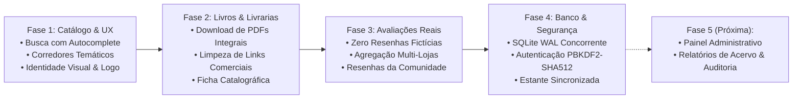
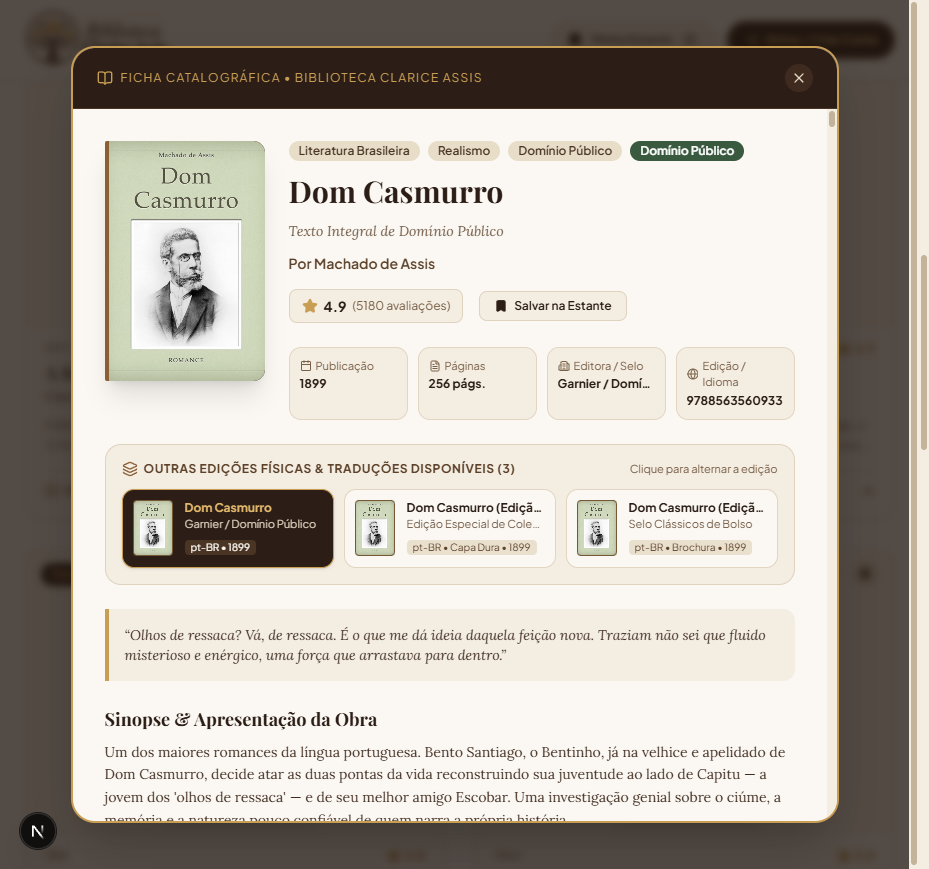
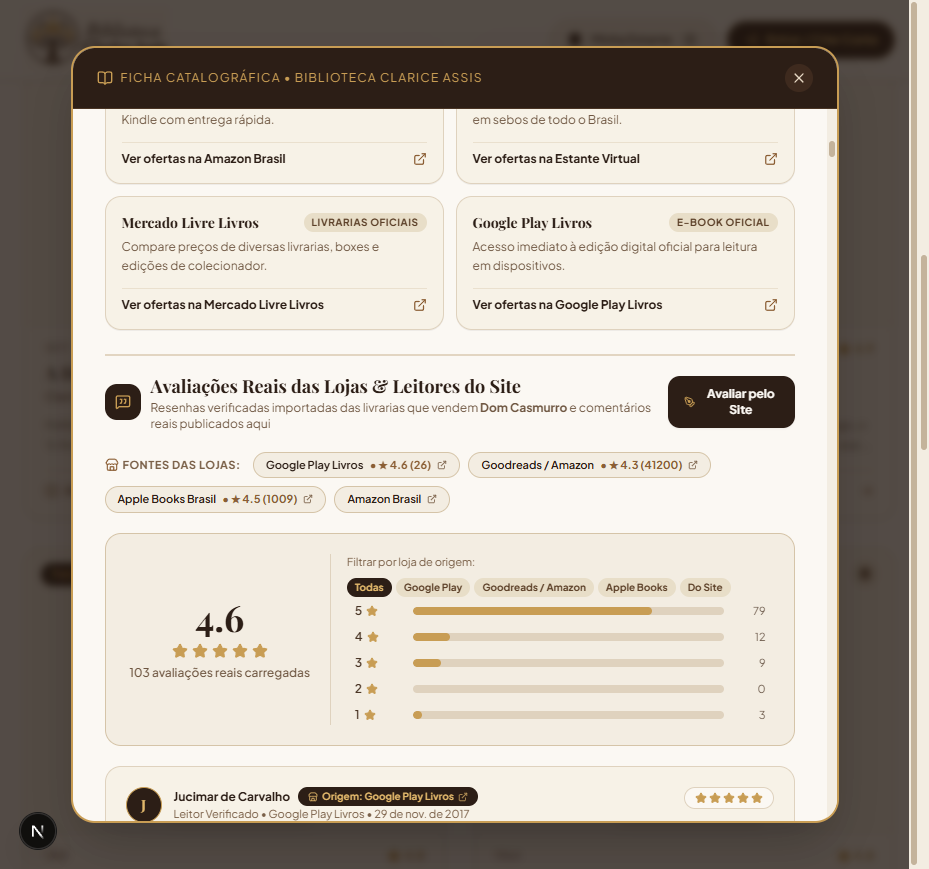
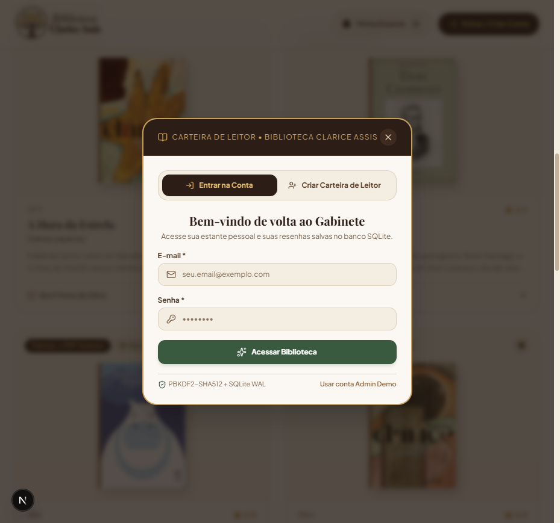

# 📜 Biblioteca Clarice Assis — Documentação Oficial do Projeto

> **Homenagem Literária:** Uma experiência digital aconchegante inspirada na profundidade psicológica de **Clarice Lispector** e na ironia fina de **Machado de Assis**.  
> **Estética Visual:** *Dark Academia*, cafeteria literária clássica, pergaminho dourado e tipografia editorial sofisticada.

---

## 🏛️ 1. Visão Geral do Sistema

A **Biblioteca Clarice Assis** é uma plataforma moderna desenvolvida com **Next.js (App Router)**, **TypeScript**, **Tailwind CSS** e **SQLite nativo (Node.js `DatabaseSync`)**. O sistema combina um vasto catálogo de livros individuais em língua portuguesa, downloads diretos de edições integrais em domínio público, comparação de livrarias reais e um ecossistema autêntico de resenhas de leitores.


---

## 🧭 2. Linha do Tempo & Fases de Desenvolvimento



---

## ⚙️ 3. Arquitetura Técnica & Tecnologias

| Camada | Tecnologia | Propósito |
| :--- | :--- | :--- |
| **Framework Web** | [Next.js](https://nextjs.org) (v16.4.6 App Router) | Renderização híbrida (SSR + RSC + Client Components) com Turbopack |
| **Linguagem** | TypeScript 5 | Tipagem estrita de modelos literários, requisições e respostas |
| **Estilização** | Tailwind CSS v4 | Tema Dark Academia personalizado (`#2C1E16`, `#FBF8F3`, `#C89D54`, `#3A5A40`) |
| **Ícones** | Lucide React | Ícones vetoriais elegantes e semânticos |
| **Banco de Dados** | SQLite Nativo (`node:sqlite` DatabaseSync) | Banco relacional zero-dependency em modo `WAL` para alta concorrência |
| **Criptografia** | PBKDF2-SHA512 (`node:crypto`) | Hash de senha com 10.000 iterações e *salts* criptográficos individuais |
| **Sessão** | Cookies `HttpOnly` com Token SHA-256 | Sessões seguras no navegador sem exposição a scripts XSS |

---

## 📚 4. Detalhamento dos Módulos Funcionais

### 4.1. Catálogo de Livros & Sugestões Instantâneas (Fase 1)
- **Busca Global em Português:** Integração com APIs literárias oficiais (Apple Books BR e fallback Open Library/Wikisource), priorizando obras individuais em português.
- **Filtro Anti-Combos/Boxes:** Remoção de pacotes genéricos (*"Box 27 peças Shakespeare"*), exibindo apenas obras unitárias.
- **Autocomplete Estilo Google:** Caixa de pesquisa dinâmica que sugere títulos e autores em tempo real conforme a digitação.
- **Corredores Literários:** Navegação por estantes temáticas:
  - *Acervo Clarice & Assis*
  - *Clássicos Universais*
  - *Filosofia & Poesia*
  - *Ficção, Mistério & Fantasia*
  - *Ciência, História & Saberes*

---

### 4.2. Ficha da Obra, Download Seguro de PDF & Onde Comprar (Fase 2)
Cada livro selecionado abre uma gaveta catalográfica refinada contendo capa em alta resolução, citação emblemática, sinopse, dados editoriais e seleção de edições físicas/capa dura.



#### Download Direto de PDF Seguro (Anti-Corrupção de Arquivo):
- **Obras em Domínio Público Verificadas:** Integração direta com os acervos do *Wikisource Português* e *Internet Archive*, entregando livros integrais com contagem real de páginas:
  - *A Hora da Estrela* (89 págs.)
  - *Dom Casmurro* (192 págs.)
  - *Memórias Póstumas de Brás Cubas* (140 págs.)
  - *A Metamorfose* (44 págs.)
  - *Noites Brancas* (60 págs.)
  - *O Alienista* (45 págs.)
  - *Quincas Borba*, *O Cortiço*, *Esaú e Jacó*, etc.
- **Proteção contra Erros JSON:** Se uma obra possuir direitos autorais vigentes ou não estiver livremente digitalizada, o sistema **não gera arquivos `.pdf` corrompidos**. Em vez disso, o manipulador `handleDownloadPdf` emite um alerta amigável e direciona o usuário para as livrarias conveniadas.

#### Onde Comprar (Consultas Limpas):
Links diretos e higienizados (sem ISBNs internos ou códigos que quebrem as buscas) para:
- **Amazon Brasil** (Edições físicas, capa dura e Kindle)
- **Estante Virtual** (Sebos, raridades e edições de colecionador)
- **Mercado Livre Livros** (Lojas e distribuidoras oficiais)
- **Google Play Livros** (E-books digitais oficiais)

---

### 4.3. Mural de Avaliações Reais Multi-Lojas (Fase 3)
Eliminação de avaliações pré-programadas/fictícias. As opiniões são provenientes exclusivamente de compradores reais de lojas e de leitores autenticados na biblioteca.



- **Lojas Agregadas em Paralelo:**
  1. **Google Play Livros:** Extração dos comentários de compradores brasileiros via dados estruturados da Google Play Store.
  2. **Goodreads / Amazon:** Captura de resenhas em língua portuguesa com verificação heurística de idioma.
  3. **Apple Books Brasil:** Feed RSS oficial de opiniões e classificações da loja brasileira.
  4. **Biblioteca Clarice Assis (Site):** Opiniões registradas por usuários no próprio sistema e gravadas no banco SQLite.
- **Identificação da Loja:** Cada resenha exibe o selo com a loja de origem e link clicável para a avaliação original.
- **Filtros Interativos:** O leitor pode filtrar as opiniões por estrelas (1 a 5) ou por fonte de loja (`Todas`, `Google Play`, `Goodreads / Amazon`, `Apple Books`, `Do Site`).

---

### 4.4. Banco de Dados SQLite, Autenticação & Estante Pessoal (Fase 4)
Implementação de infraestrutura persistente completa com isolamento de concorrência.



- **Localização do Banco:** Armazenado em `storage/clarice-assis.sqlite` fora da pasta `src/`, impedindo que os *watchers* do Turbopack/Next.js travem arquivos `.sqlite-wal` no Windows (resolvendo o código de erro OS 33).
- **Esquema Relacional das Tabelas:**
  - `users`: ID, nome, e-mail único, hash PBKDF2, salt, cargo literário (`reader` ou `admin`) e data de registro.
  - `sessions`: Token de sessão, ID do usuário, data de expiração e criação.
  - `reviews`: Resenhas postadas por leitores no site, associadas ao livro e ao usuário.
  - `saved_books`: Livros salvos na estante pessoal de cada usuário.
  - `pdf_issues`: Fila de notificações para incidentes de arquivos PDF (preparada para a Fase 5).
- **Rate-Limiting em Memória:** Proteção contra abusos e spam nos endpoints de autenticação e resenhas (máximo de requisições por IP).

---

## 🚀 5. Instruções para Execução e Testes Locais

### Pré-requisitos
- Node.js versão 20 ou superior (inclui `node:sqlite`).
- Git configurado.

### Passos de Instalação e Execução
```bash
# 1. Clonar o repositório
git clone https://github.com/Matheus-Putrique/Clarice-Assis.git
cd Clarice-Assis

# 2. Instalar dependências
npm install

# 3. Executar o servidor de desenvolvimento
npm run dev
```

A aplicação estará disponível em `http://localhost:3000`.

### Verificação de Tipos e Qualidade
```bash
npx tsc --noEmit
```

---

## 🔮 6. Próximos Passos (Fase 5 — Futuro)

1. **Painel do Administrador / Curador:**
   - Visualização de todas as contas cadastradas.
   - Moderação e exclusão de resenhas impróprias enviadas no site.
2. **Central de Alertas de PDF:**
   - Tela administrativa para monitorar obras onde leitores relataram PDFs ausentes em domínio público.
3. **Auditoria Geral & Otimização de Performance:**
   - Métricas do Core Web Vitals e cache de requisições externas para alta escalabilidade.

---
*Biblioteca Clarice Assis — Literatura, elegância e código refinado.*
