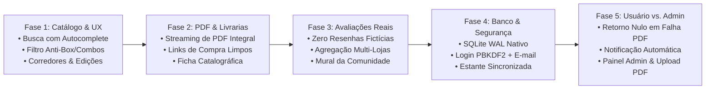
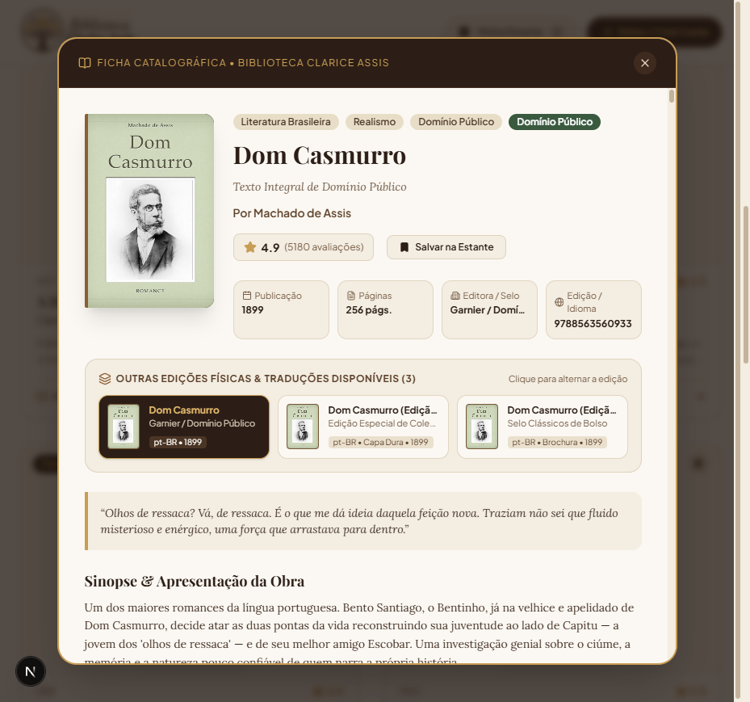
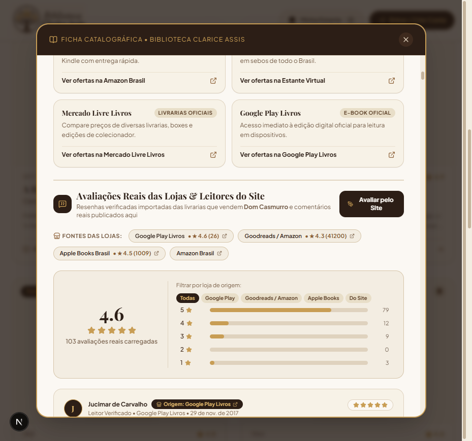
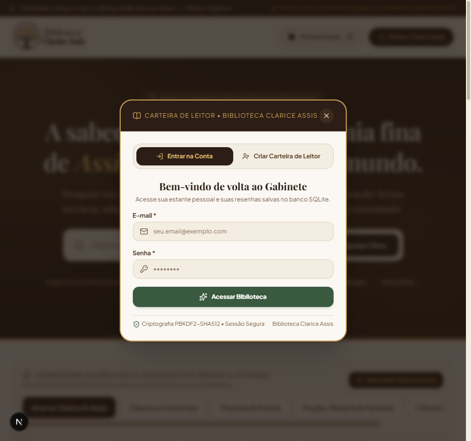

# 📜 Biblioteca Clarice Assis — Acervo Literário, Livraria & Gabinete de Leitura

<p align="center">
  
</p>

> **Homenagem Literária:** Uma plataforma digital clássica e aconchegante batizada em tributo à introspecção poética de **Clarice Lispector** e à ironia fina de **Machado de Assis**.  
> **Direção de Arte:** *Dark Academia*, cafeteria literária clássica, tons de pergaminho (`#FBF8F3`), madeira mogno (`#2C1E16`), dourado envelhecido (`#C89D54`) e verde-musgo (`#3A5A40`).

---

## 🏛️ 1. Visão Geral do Projeto

A **Biblioteca Clarice Assis** é uma aplicação web Full-Stack construída com **Next.js (App Router)**, **TypeScript**, **Tailwind CSS** e **SQLite nativo (`node:sqlite` em modo WAL)**. O sistema permite pesquisar milhões de obras individuais em língua portuguesa com sugestões instantâneas em tempo real, baixar edições integrais de livros em domínio público em formato `.PDF`, comparar ofertas nas principais livrarias brasileiras, consultar avaliações reais agregadas de múltiplas lojas, publicar resenhas próprias e gerenciar a curadoria do acervo por meio de um painel administrativo dedicado.


---

## 🧭 2. Arquitetura Incremental em 5 Fases

O projeto foi projetado e construído em **5 fases estruturadas**, garantindo código limpo, tipagem estrita e blindagem de segurança em cada camada:



---

## ⚙️ 3. Stack Tecnológica

| Camada | Tecnologia | Descrição |
| :--- | :--- | :--- |
| **Framework Full-Stack** | [Next.js 16 (App Router)](https://nextjs.org) | Server & Client Components, rotas de API REST e compilação Turbopack |
| **Linguagem** | [TypeScript 5](https://www.typescriptlang.org) | Tipagem estática ponta a ponta (zero `any`, validação com `tsc --noEmit`) |
| **Estilização** | [Tailwind CSS v4](https://tailwindcss.com) | Paleta *Dark Academia* customizada e tipografia editorial (*Playfair Display*, *Lora*, *Plus Jakarta Sans*) |
| **Banco de Dados** | SQLite Nativo (`node:sqlite`) | `DatabaseSync` operando em modo `WAL` (*Write-Ahead Logging*) para alta concorrência |
| **Segurança & Auth** | `node:crypto` (PBKDF2-SHA512) | Hash criptográfico com 10.000 iterações, *salt* aleatório por usuário e cookies `HttpOnly` |
| **Serviço de E-mail** | [Nodemailer](https://nodemailer.com) | Disparo automático de e-mail HTML de boas-vindas ao emitir a Carteira de Leitor |
| **Ícones** | [Lucide React](https://lucide.dev) | Iconografia vetorial clássica |

---

## 📚 4. Funcionalidades Detalhadas por Fase

### 🔹 Fase 1: Catálogo Global em Português, Autocomplete & Corredores
- **Autocomplete Instantâneo (Estilo Google):** Ao digitar na barra de pesquisa, sugestões de livros e autores surgem em tempo real com capa, ano, nota e atalhos de teclado.
- **Padronização Automática em Português:** Integração com catálogos literários priorizando títulos, sinopses e metadados em português brasileiro (`pt-BR`).
- **Filtro Estrito de Obras Individuais:** Algoritmo que descarta pacotes comerciais genéricos (*boxes*, *combos*, *kits* e *coleções completas*), mantendo apenas livros unitários na estante.
- **Agrupamento Inteligente de Edições:** Traduções ou variações de uma mesma obra (ex.: *Os Irmãos Karamázov* / *The Brothers Karamazov*) são unificadas sob um único card principal em português, permitindo alternar entre edições físicas (Capa Dura, Bolso, Brochura) dentro da ficha catalográfica.
- **Corredores Temáticos & Subtópicos:** Navegação rápida por *Acervo Clarice & Assis*, *Clássicos Universais*, *Filosofia & Poesia*, *Ficção, Mistério & Fantasia* e *Ciência, História & Saberes*.

---

### 🔹 Fase 2: Ficha Catalográfica, Download Direto de PDF & Livrarias


- **Streaming de Livros Completos em `.PDF`:**
  - Integração direta com acervos abertos (*Internet Archive* e *Wikisource Português*) para entregar o arquivo `.PDF` da obra integral diretamente ao computador do leitor, sem redirecionar para sites externos.
  - Exemplos de obras verificadas no catálogo aberto: *A Hora da Estrela*, *Dom Casmurro*, *Memórias Póstumas de Brás Cubas*, *O Alienista*, *Quincas Borba*, *O Cortiço*, *A Metamorfose*, *Noites Brancas*, *Crime e Castigo*, *Os Irmãos Karamázov*, *O Idiota*, *Memórias do Subsolo*, *Gente Pobre*, entre outras.
- **Links de Compra Higienizados:**
  - Geração de links diretos usando apenas `Título Limpo + Autor` (sem códigos ISBN ou IDs internos que quebrem a busca) para **Amazon Brasil**, **Estante Virtual**, **Mercado Livre Livros** e **Google Play Livros**.

---

### 🔹 Fase 3: Mural de Avaliações Reais Multi-Lojas & Comunidade


- **Zero Avaliações Fictícias:** O sistema não possui comentários pré-fabricados. Todas as avaliações exibidas são reais.
- **Agregação Paralela de 3 Grandes Plataformas + Site:**
  1. **Google Play Livros:** Extração de avaliações reais de leitores brasileiros com data e contagem de curtidas.
  2. **Goodreads / Amazon:** Coleta de resenhas verificadas em língua portuguesa.
  3. **Apple Books Brasil:** Integração com o feed oficial de avaliações de compradores da loja brasileira.
  4. **Leitores do Site (SQLite):** Qualquer leitor pode publicar sua própria avaliação na página do livro, que fica gravada permanentemente no banco de dados.
- **Rastreabilidade & Filtros:** Cada avaliação exibe um selo com a **loja de origem** e o link para a avaliação original, além de filtros interativos por loja e por estrelas (1★ a 5★).

---

### 🔹 Fase 4: Banco de Dados SQLite, Carteira de Leitor & E-mail de Boas-Vindas


- **Persistência Relacional em SQLite (`WAL`):**
  - Isolamento do arquivo do banco na pasta `/storage/` (fora de `src/` e ignorada pelo Git), evitando conflitos de *file watcher* com o Turbopack e garantindo que nenhum dado sensível seja exposto no repositório.
- **Autenticação Criptografada & Sessões `HttpOnly`:**
  - Senhas protegidas com `PBKDF2-SHA512` (10.000 iterações + *salt* individual de 16 bytes) e comparação com `crypto.timingSafeEqual`.
- **E-mail Automático de Boas-Vindas:**
  - Assim que um novo leitor cria sua conta, a **Biblioteca Clarice Assis** dispara automaticamente um e-mail HTML personalizado com os dados da sua *Carteira Oficial de Membro* via SMTP (`Nodemailer`).
- **Minha Estante Sincronizada:**
  - Os livros favoritados pelo usuário são sincronizados automaticamente na tabela `saved_books` do SQLite.

---

### 🔹 Fase 5: Divisão Usuário vs. Admin, Retorno Nulo em PDF & Painel de Manutenção
- **Tratamento Inteligente de Falha no PDF (`return null` + Notificação ao Admin):**
  - Se um livro não possuir PDF público disponível ou o link apresentar falha, o sistema **retorna `null`** (nunca baixa um arquivo corrompido nem substitui por outro livro).
  - O usuário recebe um aviso claro na ficha da obra informando que o PDF está indisponível/em manutenção e que **o Administrador já foi notificado automaticamente**.
  - Também há o botão **"Reportar Problema no PDF"** para notificações manuais dos leitores.
- **Painel do Bibliotecário Chefe (Modo Admin):**
  - **Fila de Chamados de PDF (`pdf_issues`):** Exibe todos os alertas automáticos e manuais pendentes.
  - **Reparo & Upload Direto de `.PDF` (`custom_pdfs`):** O Admin pode resolver qualquer chamado colando uma nova URL válida ou fazendo **upload de um arquivo `.PDF` direto do computador** (com validação de cabeçalho binário `%PDF`).
  - **Moderação de Avaliações & Gestão de Usuários:** Permite moderar/excluir comentários feitos no site e gerenciar permissões de contas.

---

## 🔒 5. Segurança & Privacidade no Repositório

- **Zero Credenciais Expostas no Código:** Nenhum e-mail ou senha de administrador consta no código-fonte ou no histórico público. A conta de administrador é provisionada exclusivamente via variáveis de ambiente locais (`.env.local`).
- **Proteção de Arquivos Sensíveis (`.gitignore`):**
  - `.env` e `.env.*` (chaves privadas, credenciais admin e SMTP) são estritamente ignorados.
  - `/storage/` e `*.sqlite*` (banco de dados local, uploads e logs) são estritamente ignorados.
- **Rate Limiting & Sanitização XSS:** Todas as rotas de API (`/api/auth`, `/api/reviews`, `/api/admin`) possuem limitador de requisições por IP e higienização contra injeção de HTML/scripts.

---

## 📂 6. Estrutura de Pastas do Projeto

```text
Clarice-Assis/
├── public/
│   ├── logo-clarice-assis.png       # Logotipo principal da Biblioteca Clarice Assis
│   ├── logo-emblem.png              # Emblema da árvore literária
│   └── screenshots/                 # Capturas de tela da documentação
├── src/
│   ├── app/
│   │   ├── api/
│   │   │   ├── admin/route.ts       # API do Painel Admin (chamados PDF, uploads, moderação)
│   │   │   ├── auth/route.ts        # API de Login, Cadastro e disparo do E-mail de Boas-Vindas
│   │   │   ├── books/route.ts       # API de Busca Global em PT-BR e agrupamento de edições
│   │   │   ├── pdf/route.ts         # API de Streaming de PDF completo e alerta automático
│   │   │   ├── reviews/route.ts     # API agregadora de avaliações (Google Play, Goodreads, Apple, SQLite)
│   │   │   └── shelf/route.ts       # API de sincronização da Minha Estante no SQLite
│   │   ├── globals.css              # Estilos globais e tema Dark Academia
│   │   ├── layout.tsx               # Layout raiz, fontes e metadados SEO
│   │   └── page.tsx                 # Interface principal da Biblioteca Clarice Assis
│   ├── components/
│   │   ├── AdminPanelModal.tsx      # Painel do Bibliotecário Chefe (Fase 5)
│   │   ├── AuthModal.tsx            # Modal de Login e Emissão da Carteira de Leitor (Fase 4)
│   │   └── BookReviewsSection.tsx   # Mural e formulário de avaliações multi-lojas (Fase 3)
│   ├── data/
│   │   ├── curated-books.ts         # Acervo de honra e corredores temáticos
│   │   └── initial-reviews.ts       # Definições de tags literárias (sem avaliações fictícias)
│   ├── lib/
│   │   ├── auth.ts                  # Validação de sessão HttpOnly
│   │   ├── book-links.ts            # Higienização de links de compra e recursos de PDF
│   │   ├── db.ts                    # Conexão SQLite WAL, tabelas, PBKDF2 e rate-limiter
│   │   └── mailer.ts                # Motor de envio do E-mail HTML de Boas-Vindas (Nodemailer)
│   └── types/
│       ├── book.ts                  # Interfaces TypeScript do domínio literário
│       └── node-sqlite.d.ts         # Tipagem do módulo nativo node:sqlite
├── .env.example                     # Modelo público de variáveis de ambiente (sem segredos)
├── .gitignore                       # Bloqueio de arquivos sensíveis (.env*, /storage/, *.sqlite*)
├── next.config.ts                   # Configuração do Next.js
├── package.json                     # Dependências e scripts
└── tsconfig.json                    # Configuração estrita do TypeScript
```

---

## 🚀 7. Como Executar o Projeto Localmente

### Pré-requisitos
- **Node.js 20+** (com suporte nativo a `node:sqlite`)
- **Git**

### Passo a Passo

```bash
# 1. Clone o repositório
git clone https://github.com/Matheus-Putrique/Clarice-Assis.git
cd Clarice-Assis

# 2. Instale as dependências
npm install

# 3. Configure suas variáveis de ambiente privadas
cp .env.example .env.local
```

Edite o arquivo `.env.local` (que nunca sobe para o GitHub) definindo o e-mail e uma senha forte para o Administrador, além das credenciais SMTP opcionais:

```env
ADMIN_NAME="Bibliotecário Chefe"
ADMIN_EMAIL="seu-email-admin@dominio.com"
ADMIN_PASSWORD="SuaSenhaSuperForteAqui"

# Opcional: Servidor SMTP para entrega externa de e-mails de boas-vindas
SMTP_HOST=""
SMTP_PORT="587"
SMTP_USER=""
SMTP_PASS=""
SMTP_FROM="Biblioteca Clarice Assis <no-reply@seudominio.com>"
```

```bash
# 4. Inicie o servidor de desenvolvimento
npm run dev
```

Acesse **[http://localhost:3000](http://localhost:3000)** no seu navegador.

---
*Desenvolvido com dedicação literária — Biblioteca Clarice Assis.*
